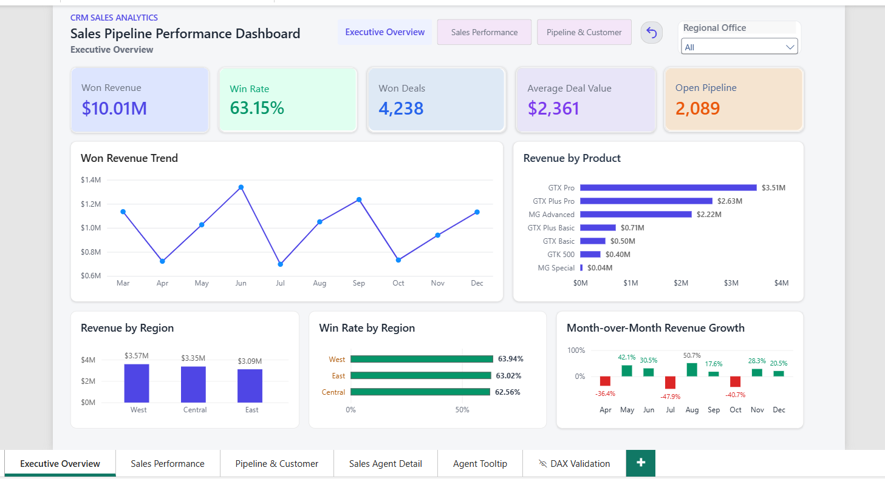
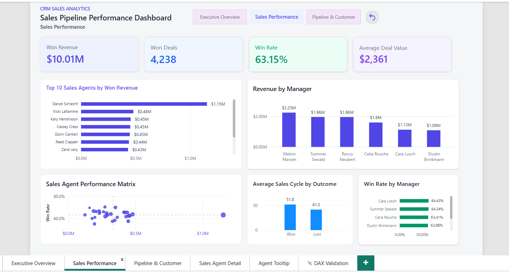
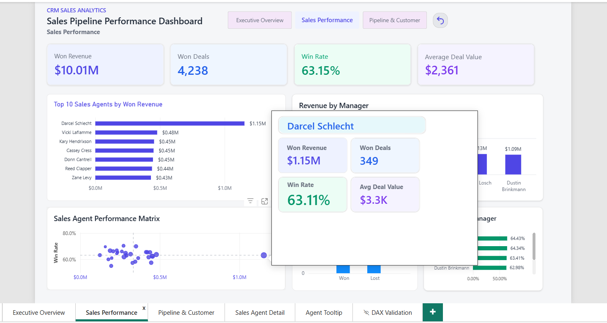
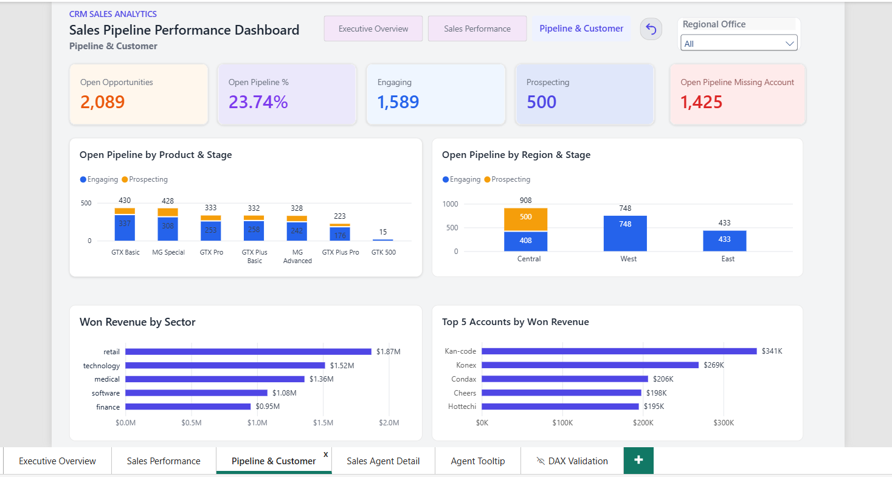
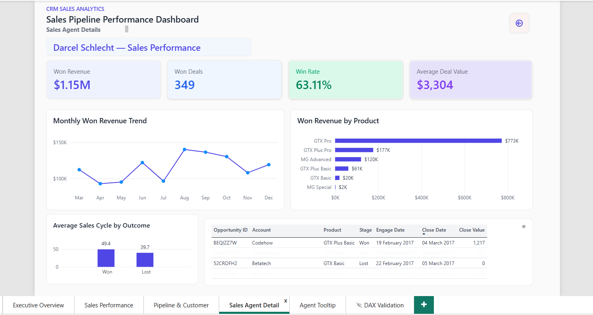

# CRM Sales Pipeline Analytics | End-to-End Data Analytics Project

**Tools:** Excel · Power Query · PostgreSQL · Python · Power BI · DAX

## Project Overview

This end-to-end data analytics project examines a B2B sales pipeline containing **8,800 opportunities** across multiple products, accounts, sales agents, and regional offices.

The objective is to transform raw CRM data into actionable business insights by analyzing sales revenue, conversion rates, pipeline health, product performance, regional trends, sales team productivity, and customer data quality.

The project demonstrates a complete analytics workflow:

**Data Understanding → Data Cleaning → Data Modeling → SQL Analysis → Python EDA → DAX → Interactive Power BI Dashboards → Business Recommendations**

## Key Results

| Business Metric | Result |
|---|---:|
| Total Opportunities | 8,800 |
| Won Revenue | $10,005,534 |
| Won Opportunities | 4,238 |
| Closed-Deal Win Rate | 63.15% |
| Open Opportunities | 2,089 |
| Average Won Deal Value | $2,360.91 |
| Average Sales Cycle | 47.99 days |

## Dashboard Pages

The Power BI report contains four business-facing pages:

1. **Executive Overview** — Revenue trends, KPIs, product and regional performance.
2. **Sales Performance** — Agent rankings, manager performance, win rates, and sales cycles.
3. **Pipeline & Customer** — Open opportunities, pipeline stages, customer and sector analysis.
4. **Sales Agent Detail** — Drill-through analysis with agent-specific KPIs and opportunity records.

The dashboard includes interactive filters, report-page tooltips, drill-through navigation, and reset controls.

## Dataset Description

The project uses four related Excel datasets representing a B2B CRM sales environment.

| Dataset | Description | Key Fields |
|---|---|---|
| `sales_pipeline.xlsx` | Sales opportunities, deal stages, deal values, and engagement/closing dates | `opportunity_id`, `sales_agent`, `product`, `account`, `deal_stage`, `engage_date`, `close_date`, `close_value` |
| `accounts.xlsx` | Customer account information and industry classification | `account`, `sector` |
| `products.xlsx` | Product reference information | `product` |
| `sales_teams.xlsx` | Sales agents, managers, and regional offices | `sales_agent`, `manager`, `regional_office` |

### Business Questions

The analysis addresses the following questions:

1. How much revenue has the business generated, and what is its closed-deal win rate?
2. Which products, regions, agents, and managers contribute the most revenue?
3. How does revenue change over time?
4. How many opportunities remain open, and how are they distributed across pipeline stages?
5. Which customers and sectors contribute the most won revenue?
6. How long does it take to close sales opportunities?
7. What CRM data quality issues could affect reporting and decision-making?

## Data Modeling

The Power BI semantic model uses `sales_pipeline` as the central fact table, connected to lookup tables for products, accounts, sales teams, and dates.

### Table Relationships

| Lookup Table | Relationship | Fact Table |
|---|---|---|
| `products[product]` | One-to-many | `sales_pipeline[product]` |
| `accounts[account]` | One-to-many | `sales_pipeline[account]` |
| `sales_teams[sales_agent]` | One-to-many | `sales_pipeline[sales_agent]` |
| `DateTable[Date]` | One-to-many, active | `sales_pipeline[close_date]` |
| `DateTable[Date]` | One-to-many, inactive | `sales_pipeline[engage_date]` |

The model supports product, customer, regional, sales team, and time-based analysis.

The inactive engagement-date relationship can be activated in specific DAX calculations using `USERELATIONSHIP` when engagement-date analysis is required.

### Data Preparation

Power Query was used to prepare the datasets for analysis, including:

- Inspecting column data types and data quality.
- Reviewing missing account information.
- Validating deal stages and date fields.
- Preparing lookup tables and relationships.
- Supporting consistent calculations across the reporting model.

## End-to-End Project Architecture

The project follows this analytical workflow:

**Excel Source Data → Power Query Transformation → Data Modeling → PostgreSQL Analysis → Python EDA → DAX Measures → Power BI Dashboard → Business Insights**

PostgreSQL and Python provide complementary analytical and validation workflows; they are not required to be direct data sources for the Power BI report.

### Technologies Used

| Technology | Role |
|---|---|
| Excel | Source data storage and initial inspection |
| Power Query | Data cleaning and transformation |
| PostgreSQL | SQL analysis and metric validation |
| Python | Exploratory data analysis |
| Pandas, NumPy, Matplotlib, Seaborn | Data processing and visualization |
| Power BI | Data modeling and interactive reporting |
| DAX | Business measures and KPI calculations |
| GitHub | Version control and project presentation |

## SQL Analysis — PostgreSQL

PostgreSQL was used to analyze the CRM data, validate business metrics, and investigate sales performance across products, regions, customers, and sales teams.

### Analysis Performed

- Validated opportunity counts, deal stages, and missing values.
- Calculated won revenue, closed-deal win rate, and average deal value.
- Analyzed revenue and conversion performance by product and region.
- Compared sales agent and manager performance.
- Investigated open pipeline distribution and missing account information.
- Analyzed sales-cycle duration for won and lost opportunities.

### Key SQL Findings

| Metric | Result |
|---|---:|
| Total Opportunities | 8,800 |
| Closed Opportunities | 6,711 |
| Won Opportunities | 4,238 |
| Lost Opportunities | 2,473 |
| Open Opportunities | 2,089 |
| Won Revenue | $10,005,534 |
| Win Rate | 63.15% |

SQL results were used to cross-check the corresponding Python and Power BI calculations.

## Python Exploratory Data Analysis

Python was used to explore the four CRM datasets, investigate business patterns, and validate analytical results.

**Libraries:** Pandas, NumPy, Matplotlib, Seaborn

### Analysis Performed

- Loaded the Excel datasets using Pandas.
- Examined dataset structures, column types, and missing values.
- Analyzed opportunity counts and deal-stage distribution.
- Investigated revenue performance across products and regions.
- Examined sales team and customer-level performance.
- Evaluated sales-cycle duration and open pipeline characteristics.
- Created exploratory visualizations to support business findings.

The analysis is available in `Python/CRM_Sales_Pipeline_EDA.ipynb`.

## Power BI and DAX

Power BI was used to create an interactive reporting solution with reusable DAX measures and a relational data model.

### Core DAX Measures

| Measure | Business Purpose |
|---|---|
| Total Opportunities | Counts all recorded opportunities |
| Won Opportunities | Counts successfully won deals |
| Lost Opportunities | Counts lost deals |
| Won Revenue | Calculates revenue from won opportunities |
| Win Rate % | Measures won deals as a percentage of closed deals |
| Average Won Deal Value | Calculates average revenue per won deal |
| Open Opportunities | Counts Engaging and Prospecting opportunities |
| Open Pipeline % | Measures the share of opportunities still open |
| Average Sales Cycle | Measures average days from engagement to closure |
| MoM Revenue Growth % | Compares revenue with the previous month |
| YTD Won Revenue | Calculates cumulative won revenue year-to-date |
| Product Revenue Share % | Measures each product's contribution to won revenue |
| Open Pipeline Missing Account % | Measures account-data incompleteness among open opportunities |
| Sales Agent Revenue Rank | Ranks sales agents by won revenue |

### Interactive Dashboard Features

- Regional filtering and cross-filtering between visuals.
- Monthly revenue trends and month-over-month comparisons.
- Product, region, agent, manager, sector, and customer performance analysis.
- Sales agent report-page tooltips with dynamically filtered KPIs.
- Sales agent drill-through with opportunity-level details.
- Page navigation and reset controls.

### Metric Validation

Key metrics were cross-validated across PostgreSQL, Python, and Power BI to ensure consistent business definitions and reliable reporting.

## Power BI Dashboard Preview

The interactive Power BI report contains four analytical pages designed to support sales leadership and operational decision-making.

The dashboard includes interactive slicers, KPI cards, cross-filtering, custom report-page tooltips, drill-through navigation, and reset controls.

### 1. Executive Overview



Provides a high-level view of won revenue, win rate, won deals, average deal value, open opportunities, monthly revenue trends, and regional performance.

### 2. Sales Performance



Compares sales agents and managers using revenue, conversion rates, deal values, and sales-cycle metrics.

The dashboard includes Top 10 Sales Agents analysis, manager-level performance comparisons, interactive report-page tooltips, and agent drill-through functionality.

#### Interactive Sales Agent Tooltip



**Dynamic Report-Page Tooltip:** Hovering over a sales agent in the Top 10 Sales Agents chart displays a customized tooltip with agent-specific Won Revenue, Won Deals, Win Rate, and Average Deal Value.

The tooltip automatically updates based on the hovered sales agent, allowing users to explore individual performance without navigating away from the Sales Performance dashboard.

### 3. Pipeline & Customer Analysis



Analyzes open opportunities by stage, region, and product, alongside customer and sector revenue contributions and CRM account-data completeness.

This page helps identify pipeline bottlenecks, revenue concentration, and customer-data quality risks.

### 4. Sales Agent Detail



Provides agent-specific KPIs, monthly revenue trends, product performance, sales-cycle analysis, and opportunity-level records.

**Drill-Through Functionality:** Users can right-click a sales agent from the Sales Performance dashboard and navigate to this detailed page. The report automatically filters the information for the selected agent.

## Key Business Insights

### 1. Overall Sales Performance

The company generated **$10.01M in won revenue** from 4,238 successful opportunities, with a **63.15% closed-deal win rate**.

Of 8,800 opportunities, 6,711 are closed and 2,089 remain open.

**Recommendation:** Review open opportunities regularly, investigate lost-deal patterns, and improve follow-up strategies to increase conversions.

### 2. Regional Pipeline Concentration

West generated the highest regional won revenue at approximately **$3.57M**, followed by Central at $3.35M and East at $3.09M.

Central contains all **500 Prospecting-stage opportunities**, suggesting a need to investigate regional pipeline management practices.

**Recommendation:** Review Central's Prospecting opportunities and compare lead qualification and stage-update processes across regions.

### 3. Product Revenue Concentration

GTX Pro generated approximately **$3.51M**, followed by GTX Plus Pro at $2.63M and MG Advanced at $2.22M.

These three products collectively contributed approximately **83.6% of total won revenue**.

GTX Basic and MG Special have the largest open opportunity counts, with 430 and 428 respectively.

**Recommendation:** Monitor revenue concentration, assess product-level conversion opportunities, and prioritize follow-ups based on deal value and likelihood of conversion.

### 4. Sales Team Performance

Darcel Schlecht led individual agents with approximately **$1.15M in won revenue**, 349 won opportunities, and a 63.11% win rate.

Melvin Marxen led sales managers with approximately **$2.25M in team won revenue**.

**Recommendation:** Identify effective sales practices and compare performance using normalized metrics that account for team size, opportunity allocation, and average deal value.

### 5. CRM Data Quality Risk

**1,425 of 2,089 open opportunities (68.21%)** have missing account information, limiting customer-level pipeline analysis.

All opportunities with missing account information are currently in open pipeline stages.

**Recommendation:** Investigate missing account records and introduce stage-appropriate CRM data completeness checks to improve pipeline reporting and customer-level analysis.

### Detailed Business Insights

For a comprehensive explanation of findings, business impacts, and recommendations, refer to:

[Business Insights & Executive Summary](Business_insights/CRM_Business_Insights.md)

## Project Repository Structure

```text
CRM_Sales_Pipeline_Analytics/
│
├── Raw_Data/
│   ├── accounts.xlsx
│   ├── products.xlsx
│   ├── sales_pipeline.xlsx
│   └── sales_teams.xlsx
│
├── Power_Query/
│   └── [Excel files used as Power BI data sources]
│
├── PostgreSQL/
│   └── [SQL analysis scripts]
│
├── Python/
│   ├── CRM_Sales_Pipeline_EDA.ipynb
│   └── requirements.txt
│
├── PowerBI/
│   └── CRM_Sales_Pipeline_Dashboard.pbix
│
├── Dashboard_Screenshots/
│   ├── 01_Executive_Overview.png
│   ├── 02_Sales_Performance.png
│   ├── 02_2_Sales_Performance.png
│   ├── 03_Pipeline_Customer.png
│   └── 04_Sales_Agent_Detail.png
│
├── Business_insights/
│   └── CRM_Business_Insights.md
│
├── Documentation/
│
└── README.md
```

## How to Explore This Project

### Prerequisites

- Microsoft Power BI Desktop
- Microsoft Excel
- PostgreSQL
- Python 3.x
- Jupyter Notebook or VS Code with the Jupyter extension

### 1. Download the Repository

Clone the repository after it has been published to GitHub, or download it as a ZIP file and extract it.

### 2. Explore the Raw Data

Open the `Raw_Data` folder to review the four CRM source datasets.

### 3. Review the SQL Analysis

Open the `PostgreSQL` folder to inspect the SQL scripts used for business analysis and metric validation.

To execute the scripts, first load the datasets into PostgreSQL and ensure the table names and schema match the SQL queries.

### 4. Run the Python EDA Notebook

Open a terminal in the project directory.

Install the required libraries:

```bash
pip install -r Python/requirements.txt
```

Open `Python/CRM_Sales_Pipeline_EDA.ipynb` in VS Code or Jupyter Notebook.

Run the notebook with the working directory set to the `Python` folder so that its relative dataset paths resolve correctly.

### 5. Explore the Power BI Dashboard

Open:

`PowerBI/CRM_Sales_Pipeline_Dashboard.pbix`

The report includes four business-facing pages, custom tooltips, interactive filters, and drill-through analysis.

**Important:** The Power BI queries reference Excel files in the original project's `Power_Query` folder. After downloading the repository to a different computer, update the file paths in Power Query before refreshing the report.

To update the paths:

1. Open Power BI Desktop.
2. Select **Transform Data**.
3. Open each Excel query and locate its **Source** step.
4. Change the source file path to the corresponding file in your local `Power_Query` folder.
5. Select **Close & Apply**, then refresh the report.

The report can be reviewed without connecting directly to PostgreSQL.

### 6. Review Business Insights

Read `Business_insights/CRM_Business_Insights.md` for the executive summary, analytical findings, and business recommendations.

## Project Outcomes

This project demonstrates practical, end-to-end data analytics skills, including:

- Understanding business requirements and translating them into analytical questions.
- Preparing and validating CRM datasets using Power Query.
- Building a relational Power BI data model.
- Writing PostgreSQL queries for sales and pipeline analysis.
- Performing exploratory data analysis with Python.
- Developing DAX measures for business KPIs and time intelligence.
- Designing interactive Power BI dashboards with tooltips and drill-through.
- Cross-validating results across analytical tools.
- Communicating findings through business insights and recommendations.
- Organizing an analytics project for GitHub portfolio presentation.

## Conclusion

The CRM Sales Pipeline Analytics project transforms raw B2B sales opportunity data into an interactive reporting solution.

The analysis highlights revenue performance, sales conversion, regional and product trends, team productivity, pipeline composition, and customer-data quality issues.

By combining Excel, Power Query, PostgreSQL, Python, DAX, and Power BI, the project demonstrates an end-to-end analytical workflow focused on generating reliable metrics and actionable business recommendations.

---

**Project Type:** End-to-End Data Analytics Portfolio Project

**Domain:** B2B Sales / CRM / Sales Operations

**Primary Skills:** SQL | Python | Power BI | DAX | Power Query | Data Modeling | Business Analysis
